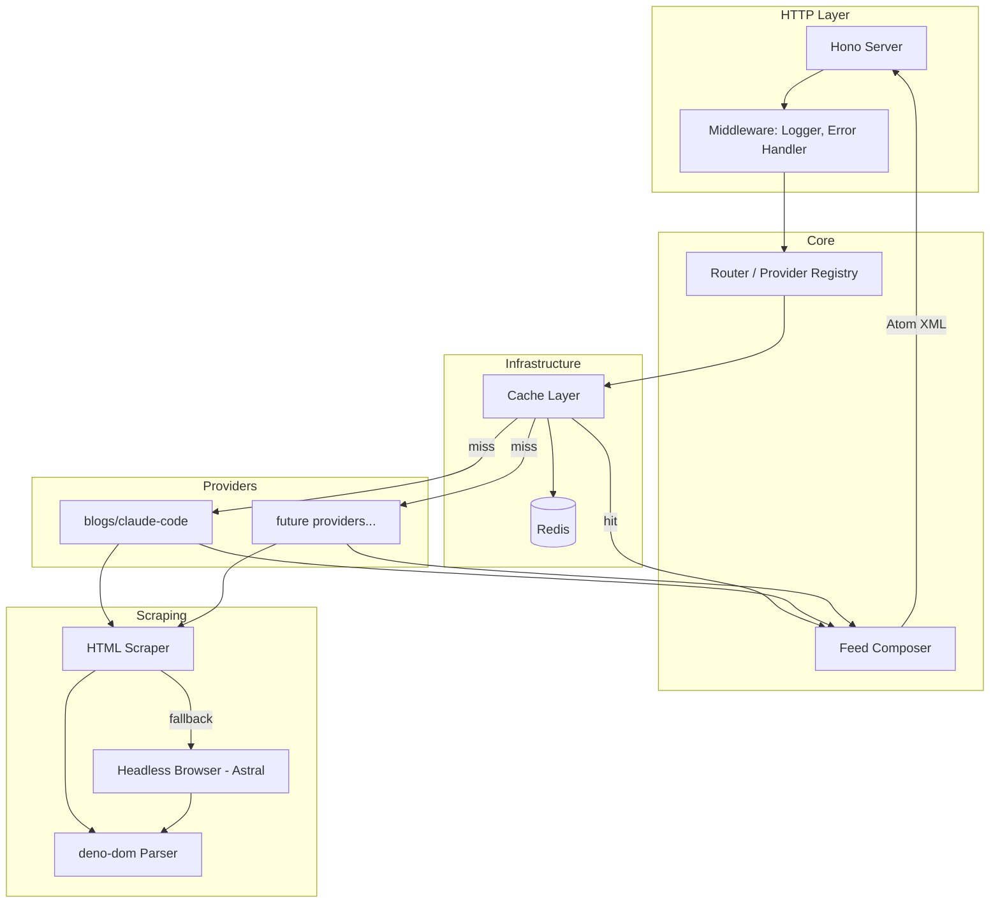
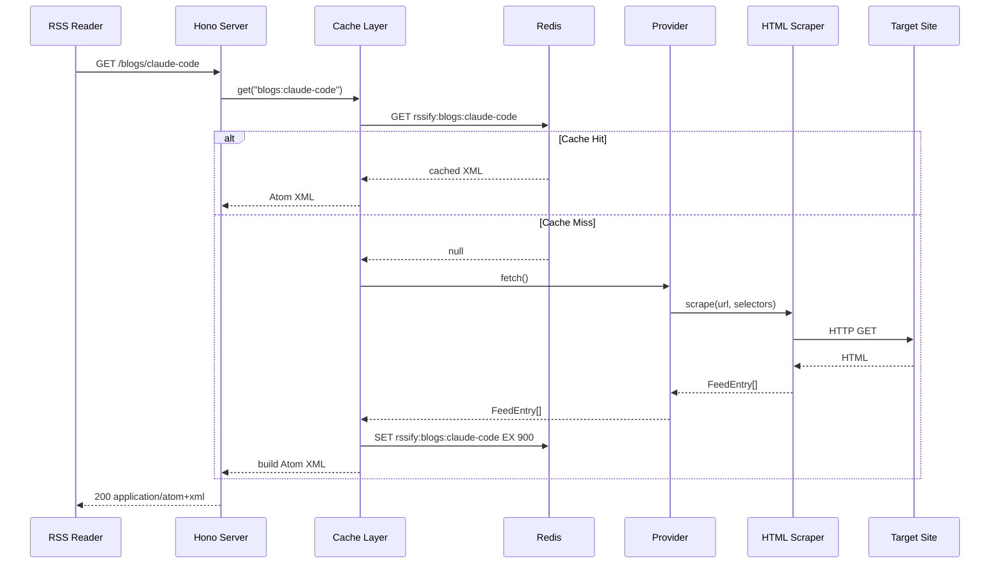

# Design Document: Rssify — RSS Proxy Service

## Overview

Rssify — сервис на Deno, генерирующий Atom-фиды для сайтов без RSS. Пользователь указывает URL в формате RSSHub (например, `/blogs/claude-code`) и получает валидный Atom 1.0 XML.

### Key Changes

1. HTTP-сервер на Hono с автоматической регистрацией providers
2. Provider-система с единым интерфейсом для добавления новых источников
3. Гибридный парсинг: HTML scraping → headless browser fallback
4. MVP provider для Anthropic blog (`/blogs/claude-code`)
5. Redis-кеширование с graceful degradation
6. Docker-деплоймент (app + Redis + Chromium)

### Chosen Approach

| Problem Area | Chosen Solution | Reference |
|---|---|---|
| HTTP Routing | Hono | research.md §1 |
| HTML Parsing | deno-dom | research.md §2 |
| Headless Browser | Astral | research.md §3 |
| Atom Generation | @feed/feed | research.md §4 |
| Redis Client | @iuioiua/redis | research.md §5 |

## Architecture

### Component Diagram



### Data Flow



## Project Structure

```
rssify/
├── deno.json              # Deno config, imports, tasks
├── main.ts                # Entry point: Hono app + Deno.serve
├── providers/
│   ├── mod.ts             # Provider registry, auto-discovery
│   └── blogs/
│       └── claude-code.ts # Anthropic blog provider
├── lib/
│   ├── scraper.ts         # HTML scraping + headless browser fallback
│   ├── feed.ts            # Atom feed builder wrapper
│   ├── cache.ts           # Redis cache layer
│   └── types.ts           # Shared interfaces
├── Dockerfile
└── docker-compose.yml
```

## Components and Interfaces

### Shared Types

```typescript
// Path: lib/types.ts

export interface FeedEntry {
  id: string;
  title: string;
  link: string;
  published: Date;
  summary?: string;
  content?: string;
  categories?: string[];
}

export interface FeedMeta {
  title: string;
  description: string;
  link: string;
  id: string;
  author: string;
}

export interface Provider {
  /** Namespace for routing, e.g. "blogs" */
  namespace: string;
  /** Route pattern within namespace, e.g. "claude-code" */
  route: string;
  /** Feed metadata */
  meta: FeedMeta;
  /** Fetch entries from the source */
  fetch(): Promise<FeedEntry[]>;
}
```

### Provider Registry

```typescript
// Path: providers/mod.ts

import type { Provider } from "../lib/types.ts";

const providers = new Map<string, Provider>();

export function registerProvider(provider: Provider): void {
  const key = `${provider.namespace}/${provider.route}`;
  providers.set(key, provider);
}

export function getProvider(namespace: string, route: string): Provider | undefined {
  return providers.get(`${namespace}/${route}`);
}

export function getAllProviders(): Provider[] {
  return [...providers.values()];
}

// Auto-import all providers
import "./blogs/claude-code.ts";
```

### Anthropic Blog Provider (MVP)

```typescript
// Path: providers/blogs/claude-code.ts

import { registerProvider } from "../mod.ts";
import { scrape } from "../../lib/scraper.ts";
import type { FeedEntry, Provider } from "../../lib/types.ts";

/**
 * Anthropic research/blog page uses Next.js SSR with React Server Components.
 * Post data is embedded as JSON in the HTML via `self.__next_f.push([...])`.
 * Strategy: fetch HTML, extract JSON payload, parse post objects.
 */

const BLOG_URL = "https://www.anthropic.com/research";

interface AnthropicPost {
  title: string;
  slug: { current: string };
  publishedOn: string;
  summary: string | null;
  subjects: string[];
}

function parseEmbeddedPosts(html: string): AnthropicPost[] {
  // Extract JSON from Next.js RSC streaming data
  // Pattern: self.__next_f.push([...]) containing publication data
  const posts: AnthropicPost[] = [];
  const regex = /"title":"([^"]+)".*?"slug":\{"_type":"slug","current":"([^"]+)"\}.*?"publishedOn":"([^"]+)".*?"summary":("([^"]*?)"|null)/g;
  // Actual implementation will parse the structured JSON payload
  return posts;
}

const provider: Provider = {
  namespace: "blogs",
  route: "claude-code",
  meta: {
    title: "Anthropic Research Blog",
    description: "Latest research and updates from Anthropic",
    link: "https://www.anthropic.com/research",
    id: "rssify:blogs:claude-code",
    author: "Anthropic",
  },
  async fetch(): Promise<FeedEntry[]> {
    const html = await scrape(BLOG_URL);
    const posts = parseEmbeddedPosts(html);

    return posts.map((post) => ({
      id: `https://www.anthropic.com/research/${post.slug.current}`,
      title: post.title,
      link: `https://www.anthropic.com/research/${post.slug.current}`,
      published: new Date(post.publishedOn),
      summary: post.summary ?? undefined,
      categories: post.subjects,
    }));
  },
};

registerProvider(provider);
```

### HTML Scraper

```typescript
// Path: lib/scraper.ts

import { DOMParser } from "@b-fuze/deno-dom";

/**
 * Hybrid scraping: HTTP fetch first, headless browser fallback.
 * Returns raw HTML string for provider-specific parsing.
 */
export async function scrape(url: string): Promise<string> {
  // Step 1: Try simple HTTP fetch
  const response = await fetch(url, {
    headers: {
      "User-Agent": "Rssify/1.0 (RSS Feed Generator)",
    },
  });

  if (!response.ok) {
    throw new Error(`HTTP ${response.status} fetching ${url}`);
  }

  const html = await response.text();

  // Check if page has meaningful content
  if (hasContent(html)) {
    return html;
  }

  // Step 2: Fallback to headless browser
  return await scrapeWithBrowser(url);
}

function hasContent(html: string): boolean {
  const doc = new DOMParser().parseFromString(html, "text/html");
  // Provider-agnostic heuristic: check if body has substantial text
  const bodyText = doc?.body?.textContent?.trim() ?? "";
  return bodyText.length > 200;
}

async function scrapeWithBrowser(url: string): Promise<string> {
  const { launch } = await import("@astral/astral");
  const browser = await launch({
    headless: true,
  });
  try {
    const page = await browser.newPage();
    await page.goto(url, { waitUntil: "networkidle0" });
    const html = await page.evaluate(() => document.documentElement.outerHTML);
    return html;
  } finally {
    await browser.close();
  }
}

/**
 * Helper: parse HTML string into DOM Document
 */
export function parseHTML(html: string) {
  return new DOMParser().parseFromString(html, "text/html");
}
```

### Feed Composer

```typescript
// Path: lib/feed.ts

import { Atom } from "@feed/feed";
import type { FeedEntry, FeedMeta } from "./types.ts";

export function buildAtomFeed(meta: FeedMeta, entries: FeedEntry[]): string {
  const feed = new Atom({
    title: meta.title,
    description: meta.description,
    link: meta.link,
    id: meta.id,
    updated: entries.length > 0
      ? entries[0].published
      : new Date(),
    authors: [{ name: meta.author }],
  });

  for (const entry of entries) {
    feed.addItem({
      title: entry.title,
      link: entry.link,
      id: entry.id,
      updated: entry.published,
      summary: entry.summary,
      content: entry.content
        ? { body: entry.content, type: "html" }
        : undefined,
      categories: entry.categories?.map((c) => ({ name: c })),
    });
  }

  return feed.build();
}
```

### Cache Layer

```typescript
// Path: lib/cache.ts

import { RedisClient } from "@iuioiua/redis";

const DEFAULT_TTL = 900; // 15 minutes in seconds
const KEY_PREFIX = "rssify:";

let client: RedisClient | null = null;

export async function initCache(): Promise<void> {
  const redisUrl = Deno.env.get("REDIS_URL") ?? "redis://localhost:6379";
  const url = new URL(redisUrl);

  try {
    const conn = await Deno.connect({
      hostname: url.hostname,
      port: Number(url.port) || 6379,
    });
    client = new RedisClient(conn);

    // Auth if password provided
    if (url.password) {
      await client.sendCommand(["AUTH", url.password]);
    }
  } catch (error) {
    console.warn("Redis unavailable, running without cache:", error.message);
    client = null;
  }
}

export async function getCached(key: string): Promise<string | null> {
  if (!client) return null;
  try {
    const result = await client.sendCommand(["GET", KEY_PREFIX + key]);
    return result as string | null;
  } catch {
    return null;
  }
}

export async function setCache(
  key: string,
  value: string,
  ttl: number = DEFAULT_TTL,
): Promise<void> {
  if (!client) return;
  try {
    await client.sendCommand(["SET", KEY_PREFIX + key, value, "EX", String(ttl)]);
  } catch {
    // Ignore cache write failures — graceful degradation
  }
}
```

### Main Application

```typescript
// Path: main.ts

import { Hono } from "@hono/hono";
import { logger } from "@hono/hono/logger";
import { getAllProviders, getProvider } from "./providers/mod.ts";
import { buildAtomFeed } from "./lib/feed.ts";
import { getCached, initCache, setCache } from "./lib/cache.ts";

const app = new Hono();

// Middleware
app.use("*", logger());

// Health check
app.get("/health", (c) => c.json({ status: "ok" }));

// Provider routes: /:namespace/:route
app.get("/:namespace/:route", async (c) => {
  const { namespace, route } = c.req.param();
  const provider = getProvider(namespace, route);

  if (!provider) {
    return c.json({ error: "Feed not found" }, 404);
  }

  const cacheKey = `${namespace}:${route}`;

  // Try cache first
  const cached = await getCached(cacheKey);
  if (cached) {
    return c.body(cached, 200, {
      "Content-Type": "application/atom+xml; charset=utf-8",
    });
  }

  // Fetch and build feed
  const entries = await provider.fetch();
  const xml = buildAtomFeed(provider.meta, entries);

  // Cache asynchronously
  setCache(cacheKey, xml);

  return c.body(xml, 200, {
    "Content-Type": "application/atom+xml; charset=utf-8",
  });
});

// Index: list available feeds
app.get("/", (c) => {
  const feeds = getAllProviders().map((p) => ({
    name: `${p.namespace}/${p.route}`,
    title: p.meta.title,
    url: `/${p.namespace}/${p.route}`,
  }));
  return c.json({ feeds });
});

// Init and start
await initCache();

const port = Number(Deno.env.get("PORT")) || 8000;
Deno.serve({ port }, app.fetch);
```

### Deno Configuration

```jsonc
// Path: deno.json
{
  "tasks": {
    "dev": "deno run --allow-net --allow-env --allow-read --watch main.ts",
    "start": "deno run --allow-net --allow-env --allow-read main.ts"
  },
  "imports": {
    "@hono/hono": "jsr:@hono/hono",
    "@hono/hono/": "jsr:@hono/hono/",
    "@b-fuze/deno-dom": "jsr:@b-fuze/deno-dom",
    "@astral/astral": "jsr:@astral/astral",
    "@feed/feed": "jsr:@feed/feed",
    "@iuioiua/redis": "jsr:@iuioiua/redis"
  }
}
```

### Docker Configuration

```dockerfile
# Path: Dockerfile
FROM denoland/deno:2.1.4

# Install Chrome for headless browser fallback
RUN apt-get update && apt-get install -y \
    chromium \
    --no-install-recommends \
    && rm -rf /var/lib/apt/lists/*

ENV CHROME_BIN=/usr/bin/chromium
ENV DENO_DIR=/deno-dir

WORKDIR /app

# Cache dependencies
COPY deno.json .
RUN deno install

# Copy source
COPY . .

# Cache compilation
RUN deno cache main.ts

USER deno
EXPOSE 8000

CMD ["deno", "run", "--allow-net", "--allow-env", "--allow-read", "--allow-run", "main.ts"]
```

```yaml
# Path: docker-compose.yml
services:
  app:
    build: .
    ports:
      - "8000:8000"
    environment:
      - PORT=8000
      - REDIS_URL=redis://redis:6379
    depends_on:
      redis:
        condition: service_healthy
    restart: unless-stopped

  redis:
    image: redis:7-alpine
    ports:
      - "6379:6379"
    volumes:
      - redis-data:/data
    healthcheck:
      test: ["CMD", "redis-cli", "ping"]
      interval: 10s
      timeout: 5s
      retries: 3
    restart: unless-stopped

volumes:
  redis-data:
```

## Data Models

### FeedEntry

```typescript
interface FeedEntry {
  id: string;         // Unique ID (typically full URL of the post)
  title: string;      // Post title
  link: string;       // Full URL to the original post
  published: Date;    // Publication date
  summary?: string;   // Short description
  content?: string;   // Full HTML content (optional)
  categories?: string[]; // Tags/categories
}
```

### FeedMeta

```typescript
interface FeedMeta {
  title: string;       // Feed title
  description: string; // Feed description
  link: string;        // Link to the source website
  id: string;          // Unique feed ID
  author: string;      // Feed author name
}
```

## Data Flow Completeness

| Field/Entity | Types | Provider | Scraper | Feed Builder | Cache | HTTP Response |
|---|---|---|---|---|---|---|
| FeedEntry | `lib/types.ts` | `providers/blogs/*.ts` | `lib/scraper.ts` | `lib/feed.ts` | serialized JSON | Atom XML |
| FeedMeta | `lib/types.ts` | `providers/blogs/*.ts` | N/A | `lib/feed.ts` | N/A | Atom XML header |
| Cache key | string | N/A | N/A | N/A | `lib/cache.ts` | N/A |

## Error Handling

### Error Types and Handling

| Error | HTTP Status | User Message |
|---|---|---|
| Unknown route | 404 | `{"error": "Feed not found"}` |
| Target site unreachable | 502 | `{"error": "Source unavailable"}` |
| Parsing failed | 502 | `{"error": "Failed to parse source"}` |
| Redis unavailable | — | Graceful degradation, no cache |
| Headless browser failed | 502 | `{"error": "Failed to render source"}` |

Error middleware в Hono:

```typescript
app.onError((err, c) => {
  console.error(`${c.req.method} ${c.req.url}:`, err.message);
  const status = err instanceof HTTPException ? err.status : 502;
  return c.json({ error: err.message }, status);
});
```

## Testing Strategy

### Approach

Unit-тесты для каждого модуля с `Deno.test`. Integration-тест для полного flow.

### Unit Tests

```typescript
// lib/feed_test.ts
import { assertEquals } from "@std/assert";
import { buildAtomFeed } from "./feed.ts";

Deno.test("buildAtomFeed generates valid Atom XML", () => {
  const meta = {
    title: "Test Feed",
    description: "Test",
    link: "https://example.com",
    id: "test:feed",
    author: "Test",
  };
  const entries = [{
    id: "1",
    title: "Post 1",
    link: "https://example.com/1",
    published: new Date("2026-01-01"),
    summary: "Summary",
  }];

  const xml = buildAtomFeed(meta, entries);

  assertEquals(xml.includes("<feed"), true);
  assertEquals(xml.includes("<title>Post 1</title>"), true);
  assertEquals(xml.includes("application/atom+xml") || xml.includes("xmlns=\"http://www.w3.org/2005/Atom\""), true);
});
```

```typescript
// providers/blogs/claude-code_test.ts
Deno.test("parseEmbeddedPosts extracts posts from HTML", () => {
  const mockHtml = `...`; // HTML fixture with embedded Next.js data
  const posts = parseEmbeddedPosts(mockHtml);
  assertEquals(posts.length > 0, true);
  assertEquals(typeof posts[0].title, "string");
});
```

### Edge Cases

1. **Target site returns 403/429** — Provider throws, error middleware returns 502
2. **Empty post list** — Return valid Atom feed with 0 entries
3. **Redis connection lost mid-request** — Cache methods silently fail, scraping proceeds
4. **Malformed HTML** — deno-dom returns null/empty, fallback to headless browser
5. **Next.js data format changes** — parseEmbeddedPosts returns empty array, needs provider update
